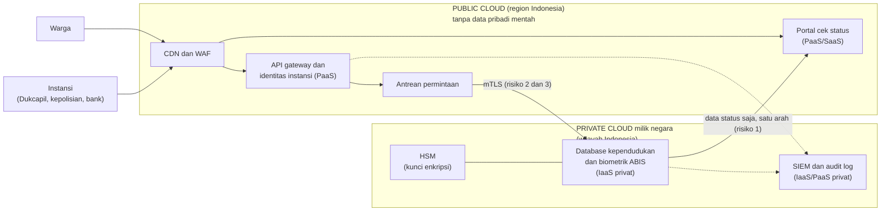

### Diagram Pendukung

Keterangan:
- Garis putus-putus: pencatatan akses untuk audit.
- Risiko 1: ketidaksinkronan data. Risiko 2: kebocoran data pribadi. Risiko 3: penyalahgunaan hak akses instansi (sesuai Jawaban Soal 3).